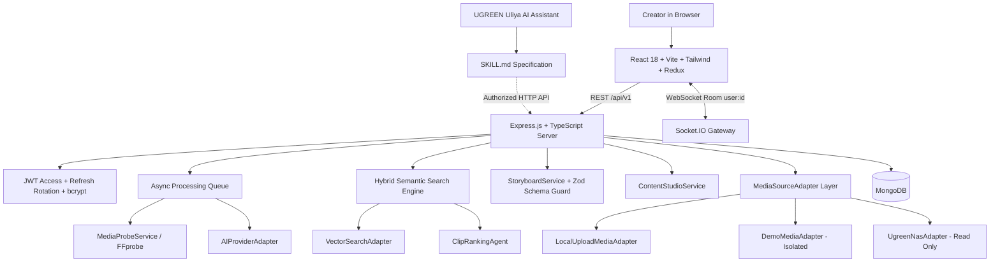

# ReelMind Architecture Documentation

## 1. System Overview

ReelMind separates lightweight NAS Skill orchestration (`skills/reelmind-studio`) from the MERN processing and creative intelligence workspace (`server/` + `client/` + `shared/`).

## 2. Multi-Agent Creative Pipeline

1. **Intent Understanding Agent**: Extracts subject query, visual keywords, mood, duration, and target aspect ratio from natural language prompts.
2. **Media Discovery Agent**: Retrieves user-owned media across authorized adapters (`local_upload`, `ugreen_nas`, and optional `demo`).
3. **Scene Understanding & Indexing**: Background worker extracts metadata, hashes (SHA-256 + sampled perceptual fingerprint), frames/thumbnails, and semantic embeddings.
4. **Hybrid Semantic Search Agent**: Combines cosine similarity across embeddings, lexical keyword matching, and audio transcript matching with explicit evidence attribution.
5. **Clip Ranking Agent**: Evaluates candidates using dynamic weight renormalization across available metrics:
   - Semantic Relevance (`0.35`)
   - Visual/Technical Quality (`0.20`)
   - Narrative Value (`0.15`)
   - Resolution Quality (`0.10`)
   - Audio Suitability (`0.10`)
   - Diversity (`0.10`)
6. **Creative Director & Storyboard Generator**: Sequences selected clips into continuous timeline slots bounded by real source clip durations, validated with Zod `StoryboardSchema`.
7. **Content Generation Agent**: Produces titles, hooks, captions, SEO descriptions, hashtags, thumbnail text, and scene narration anchored to storyboard evidence.

## 3. Security & Data Integrity Guarantees

- **Strict Ownership Isolation**: Every query scopes by `ownerId = req.user._id`, including thumbnail and media streaming routes.
- **Credential Encryption**: External AI provider keys and NAS API tokens are encrypted at rest with AES-256-GCM (`ENCRYPTION_KEY`) and never returned to the frontend.
- **Zero Fabrication Policy**:
  - Demo data is stamped with `isDemoData: true` and `sourceType: "demo"`, visibly labeled `DEMO DATA` across thumbnails, search cards, and timelines.
  - Vision inspection (`visual_analysis`) is only claimed when a vision-capable model actually inspects extracted frames; otherwise `evidenceSource` clearly reports `metadata` or `transcript`.
  - Original NAS files are never auto-deleted or modified.

